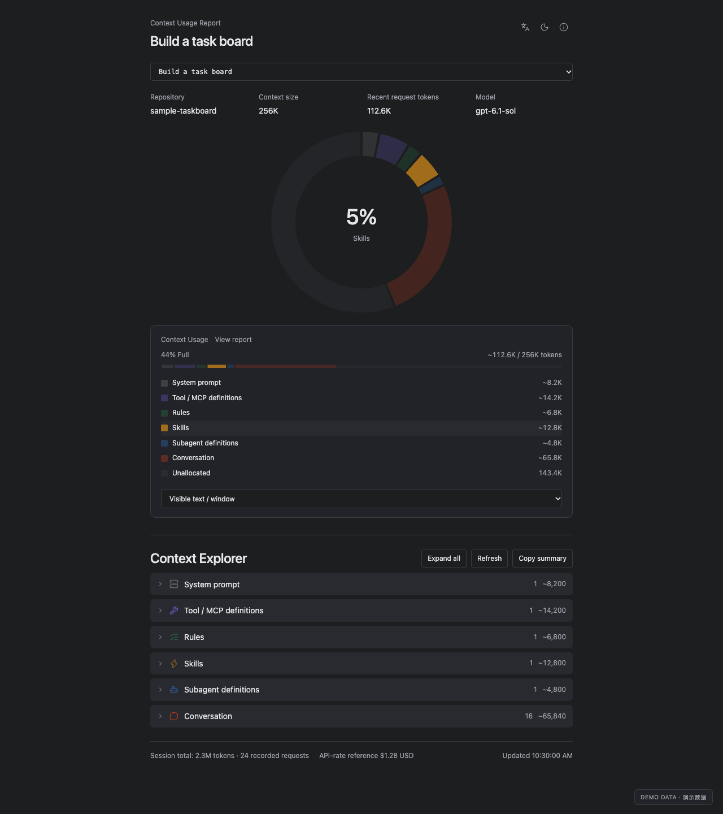
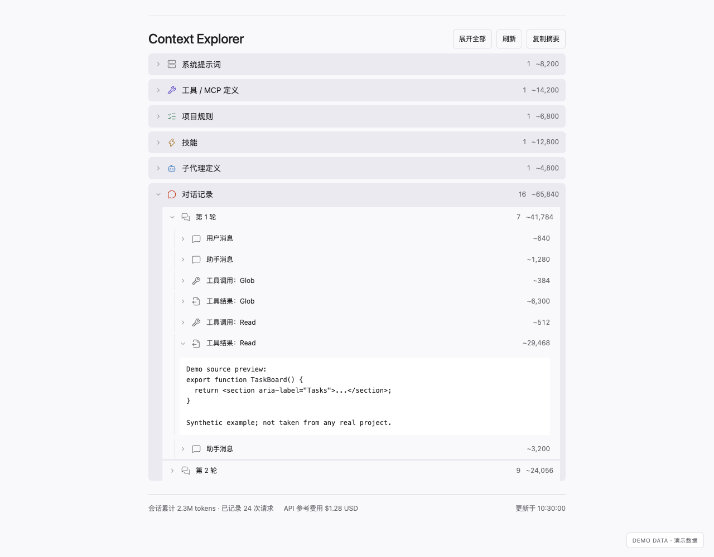

# Context Explorer for Codex

English · [简体中文](README.zh-CN.md)

A local, read-only Codex plugin that shows what fills your context window and lets you step through a session turn by turn: messages, tool calls and their results.



> **Status: early preview.** The MCP server and the browser report work on macOS. The native Codex panel and clean-machine installs are not verified yet, and Windows is untested. See [PUBLICATION.md](PUBLICATION.md).

## Features

- Context breakdown by category: system prompt, tools/MCP, rules, skills, subagents and conversation.
- Conversation → turn → messages, tool calls and results, in log order. Text loads only when you expand an entry.
- Switch between the 20 most recent main sessions.
- Session token totals and an API-rate cost reference.
- English and Chinese; light, dark and system themes. Refreshes every 5 seconds while visible, without calling the model.



Screenshots use synthetic data.

## Install

Requires Node.js 22+ and Python 3.10+.

```sh
codex plugin marketplace add popsiclelmlm/codex-context-explorer --ref main
codex plugin add context-explorer@codex-context-explorer
```

Start a new local chat, type `@`, pick **Context Explorer** and ask it to open the context report. The report opens on the most recently active session, which may not be the current chat; check the name at the top.

If the plugin doesn't appear under `@`, make sure it is enabled and restart the desktop app.

## Browser report

To use the report without installing the plugin:

```sh
git clone https://github.com/popsiclelmlm/codex-context-explorer.git
python3 codex-context-explorer/plugins/context-explorer/preview.py
```

Open the printed `127.0.0.1` URL; `Ctrl+C` stops the server. It shows your real sessions and the URL contains an access key, so don't share it.

## About the numbers

- Category sizes come from tokenizing the visible log text locally with `o200k_base`. Hidden instructions, images and encrypted reasoning can't be counted, so the gray part of the chart may include content you can't see.
- Token estimates need the optional `tiktoken` package and its cache (see [Development](#development)). Without them the estimates show as unknown; recorded request usage still works.
- Only the latest 500 text fragments keep their text, up to 8,000 characters each.
- The cost is an API-rate reference, not your subscription bill.

## Development

```sh
cd plugins/context-explorer
npm ci
python3 -m venv .venv
.venv/bin/python -m pip install -r requirements.txt
TIKTOKEN_CACHE_DIR=backend/tokenizer-cache .venv/bin/python -c "import tiktoken; tiktoken.get_encoding('o200k_base')"
npm run build
.venv/bin/python verify-turns.py
npm run verify:mcp   # reads your most recent local session
```

`npm run build` bundles the MCP server and its npm dependencies into `dist/server.mjs` and the UI into `dist/report.html`, so installed copies don't need `node_modules`. Commit `dist/` after changing `server.mjs` or `ui/`. The Python collector uses only the standard library; set `CONTEXT_EXPLORER_PYTHON` to choose a specific interpreter.

```text
.agents/plugins/marketplace.json   marketplace catalog
plugins/context-explorer/
  server.mjs    MCP server
  bridge.py     Python collector entry point
  backend/      log parsing and pricing
  ui/           report UI
  dist/         build output (committed)
```

Read [CONTRIBUTING.md](CONTRIBUTING.md) before committing.

## Privacy

The plugin reads session logs and session names under `~/.codex`. It makes no network requests and has no telemetry. Message text goes only to the report panel, never into the model's tool result.

## License

MIT. Third-party notices are in [THIRD_PARTY_NOTICES.md](THIRD_PARTY_NOTICES.md) and `plugins/context-explorer/dist/THIRD_PARTY_LICENSES.txt`.
