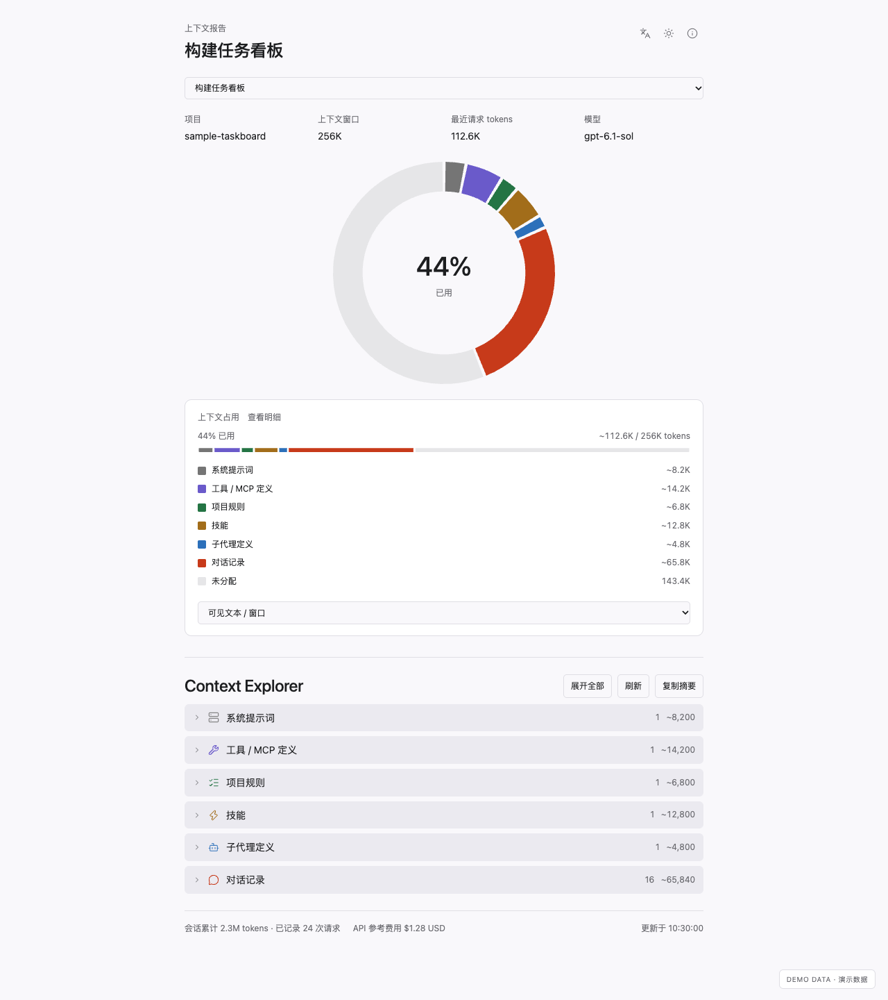

# Context Explorer for Codex

[English](README.md) · 简体中文

在 Codex 侧边栏直接查看当前会话的上下文占用，并按轮次回看消息、工具调用和结果。



> **状态：早期预览。** 已在 macOS 的 Codex 桌面端可用，并在全新的 macOS 环境中测试过从 GitHub 安装；Linux 和 Windows 未测试。详见 [PUBLICATION.md](PUBLICATION.md)。

## 安装

需要 Node.js 22+ 和 Python 3.9+（macOS 自带的 Python 即可）。

```sh
codex plugin marketplace add popsiclelmlm/codex-context-explorer --ref main
codex plugin add context-explorer@codex-context-explorer
```

`context-explorer@codex-context-explorer` 的格式是"插件名@市场名"。装完后如果找不到插件，确认插件已启用，然后重启桌面端。

更新：先执行 `codex plugin marketplace upgrade codex-context-explorer`，再执行一次上面的 `codex plugin add` 命令，然后重启桌面端。

## 使用

在 Codex 的本地聊天里发送：

```text
@Context Explorer 打开上下文报告
```

报告会在侧边内置浏览器中打开，显示最近活动会话的上下文占用，通常就是你正在用的这个聊天。页面可见时每 5 秒自动刷新，不调用模型。要看其他会话，从顶部的下拉框切换。

## 功能

- 按类别拆分上下文：系统提示词、工具 / MCP、项目规则、技能、子代理和对话。
- 对话 → 轮次 → 消息、工具调用、结果，按日志顺序排列；展开条目时才读取正文。
- 切换最近 20 个主会话。
- 会话累计 token 和 API 价格参考费用。
- 中英文界面，浅色 / 深色 / 跟随系统主题。


截图均为合成数据。

## 关于数据

- 类别大小由本地 `o200k_base` 分词统计日志中的可见文本得出（分词器已内置，无需安装）。隐藏指令、图片和加密推理无法计入，所以图中灰色部分可能包含看不到的内容。
- 只保留最近 500 个文本片段的正文，每段最多 8000 字符。
- 费用是按 API 单价算的参考值，不是订阅账单。

## 不安装插件

同一份报告也可以作为本地网页运行：

```sh
git clone https://github.com/popsiclelmlm/codex-context-explorer.git
python3 codex-context-explorer/plugins/context-explorer/preview.py
```

打开终端打印的 `127.0.0.1` 网址，按 `Ctrl+C` 停止。网址里带访问密钥，不要分享。这个网页不经过 Node，token 估算需要可选的 `tiktoken` 及其词表缓存（`requirements.txt`），否则显示为未知。

## 开发

```sh
cd plugins/context-explorer
npm ci
npm run build
python3 verify-turns.py
npm run verify:mcp   # 读取本机最近一个会话
```

`npm run build` 把 MCP 服务端连同 npm 依赖和 `o200k_base` 分词器打包成 `dist/server.mjs`，界面打包成 `dist/report.html`，安装后的插件不需要 `node_modules`，也不需要 tiktoken。修改 `server.mjs` 或 `ui/` 后要重新构建并提交 `dist/`。Python 采集器只用标准库；可用 `CONTEXT_EXPLORER_PYTHON` 指定解释器。

```text
.agents/plugins/marketplace.json   插件市场清单
plugins/context-explorer/
  server.mjs    MCP 服务端
  bridge.py     Python 采集器入口
  backend/      日志解析与计价
  ui/           报告界面
  dist/         构建产物（需提交）
```

提交前请阅读 [CONTRIBUTING.md](CONTRIBUTING.md)。

## 隐私

插件读取 `~/.codex` 下的会话日志和会话名称，不发起任何网络请求，没有遥测。消息正文只发给报告面板，不会进入模型可见的工具结果。

## 许可证

MIT。第三方许可见 [THIRD_PARTY_NOTICES.md](THIRD_PARTY_NOTICES.md) 和 `plugins/context-explorer/dist/THIRD_PARTY_LICENSES.txt`。
